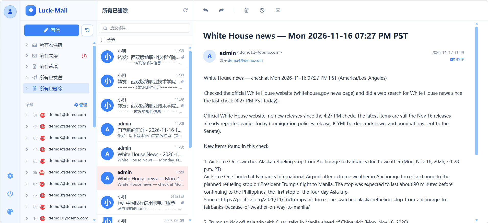

# luck-mail — Lightweight Self-Hosted Open-Source Webmail

[](CHANGELOG.md)

[中文版](README.zh-CN.md)



A lightweight, fast, self-hosted webmail for managing many mailboxes in one place.
One login, one unified inbox, no bloat. Built with **Node.js + Vue 3 + SQLite**.

- **Single user** — one login account, no multi-user complexity.
- **Unified inbox (required)** — all mailboxes merged by time; one account failing never blocks the others.
- **Real folders only** — folder lists are synced from the IMAP server via `LIST`. Never fabricated, never hard-coded.
- **Known providers auto-fill** — 163, Gmail, Outlook, QQ, iCloud and more fill in server addresses automatically.
- **Real-time push** — new mail arrives over WebSocket; unread badges light up instantly, no refresh.
- **Fast** — single Node process + SQLite (WAL + FTS5), virtual scrolling, streaming parse; attachments are never downloaded by default — metadata only, streamed live from the mail server when you click download.

Moving to a new server? See [MIGRATION.md](MIGRATION.md).

## Features

1. **Login** — Lockout after 5 failed attempts in 15 minutes. Username is case-insensitive.
2. **Add mailbox** — Foxmail-style form: email, password, IMAP server + SSL + port, SMTP server + SSL + port, STARTTLS checkbox. Known providers auto-fill servers; unknown domains default to `imap.<domain>` / `smtp.<domain>`. The backend tests IMAP + SMTP connectivity before saving. **IMAP only** — POP3 is fully removed.
3. **Manage mailboxes** — a popup table: serial number, mailbox, alias (edit inline), sort order (drag to reorder), actions (**test connectivity**, settings, temporarily disable, delete). The **Test** button checks IMAP + SMTP without opening settings. Bottom bar: **+ Add mailbox** and **Export all mailboxes** (downloads a real `.xlsx` with serial, email, authorization code, IMAP/SMTP server + port, alias), count, **OK / Cancel**.
4. **Unified inbox** — aggregate views: All Inboxes, All Unread, All Drafts, All Sent, All Trash. Click a mailbox to expand its folders and switch to its inbox. Unread counts are live.
5. **Message list** — sender avatar, sender + time, bold subject, one-line gray snippet, red unread dot before the sender name, pink selected row. Checkboxes on hover (always visible on mobile). **Batch select + batch delete** (up to 200 at a time; trash view = permanent delete, elsewhere = move to trash). While deleting, the button counts down the remaining messages ("Deleting (15)…"), the indicator belongs only to the view where the delete started, and the list stays scrollable (viewing/selecting is locked until it finishes). **Pagination** — 50 per page, with prev/next. Your current view (aggregate or a single mailbox/folder) is restored after a refresh.
6. **Reading pane** — sanitized HTML rendered in a sandboxed iframe. Hover the sender to copy their email address. A **Translate** button under the sender date translates English bodies to Chinese (free MyMemory service, no key); click again to return to the original. No reply-all / print / more-menu clutter.
7. **Compose** — subject required, attachments supported; an empty subject is auto-filled with the first attachment's filename. The sender dropdown shows serial numbers (【01】, 【02】…). Attachments are metadata-only when sent; the body lives on the mail server's Sent folder, and downloading a sent attachment streams it live from IMAP.
8. **Themes** — six color themes (blue default, green, black-white, purple, orange, cyan) via the palette button; saved in localStorage; scrollbars follow the theme.
9. **Search** — full-text search over subjects, senders and bodies (SQLite FTS5 trigram).
10. **Settings** — change username, change password (entered twice), default account (with serial numbers), signature, logout. A **Backup to local** button downloads a `.tar.gz` containing the encryption key plus a consistent database snapshot, bodies and attachments — extract it to restore the whole installation (see [MIGRATION.md](MIGRATION.md)).

## Architecture

Single Node process + SQLite. No PostgreSQL, Redis, S3 or Elasticsearch.

| Layer | Stack |
|---|---|
| Backend | Node 22 + Express + TypeScript (strict) + Socket.io + better-sqlite3 |
| Mail | imapflow (IDLE + incremental sync) + Nodemailer (send) + mailparser (streaming parse) |
| Frontend | Vue 3 + Vite + TypeScript (strict) + Pinia + Tailwind + socket.io-client |
| Storage | SQLite (WAL + FTS5 trigram); sanitized HTML bodies as files; attachments are metadata-only — content is streamed live from IMAP on download, never stored on disk |
| Security | AES-256-GCM mailbox password encryption; DOMPurify + JSDOM sanitization; sandboxed iframe (srcdoc) for bodies |

**How mail flows:** the frontend talks only to the Node backend over one WebSocket (Socket.io). imapflow keeps an IDLE connection per mailbox; on new mail the backend pushes JSON to Vue, which updates unread counts and the list. Deleting a message performs the IMAP operation on the server first (move to trash, or expunge for permanent delete), then updates the local database — client and server stay in sync.

## Known provider presets

Adding a mailbox auto-fills servers for known providers. A few examples:

| Provider | Domains | IMAP | SMTP | Password hint |
|---|---|---|---|---|
| NetEase | 163.com / 126.com / yeah.net / 188.com | imap.163.com:993 SSL | smtp.163.com:465 SSL | Client authorization code |
| Gmail | gmail.com / googlemail.com | imap.gmail.com:993 SSL | smtp.gmail.com:587 STARTTLS | App password |
| Outlook/Hotmail | outlook.com / hotmail.com / live.com / msn.com | outlook.office365.com:993 SSL | smtp.office365.com:587 STARTTLS | — |
| QQ Mail | qq.com / foxmail.com | imap.qq.com:993 SSL | smtp.qq.com:465 SSL | Authorization code |
| Tencent Exmail | (by name) | imap.exmail.qq.com:993 SSL | smtp.exmail.qq.com:465 SSL | — |
| Yahoo | yahoo.com / ymail.com / rocketmail.com | imap.mail.yahoo.com:993 SSL | smtp.mail.yahoo.com:465 SSL | App password, enable IMAP first |
| iCloud | icloud.com / me.com / mac.com | imap.mail.me.com:993 SSL | smtp.mail.me.com:587 STARTTLS | App password |
| AOL | aol.com / aim.com | imap.aol.com:993 SSL | smtp.aol.com:465 SSL | App password |
| Yandex | yandex.com / yandex.ru / ya.ru | imap.yandex.com:993 SSL | smtp.yandex.com:465 SSL | App password, enable IMAP first |
| Zoho | zoho.com / zohomail.com | imap.zoho.com:993 SSL | smtp.zoho.com:465 SSL | — |

Note: ProtonMail has no direct IMAP (requires the local Proton Bridge), so no preset is provided.

## Quick start

### Docker

```bash
docker compose up -d --build
```

Open http://localhost:8080. Create your login account on first use (only once — registration closes after that), then add your first mailbox.

### Manual (Node)

```bash
cd backend && npm install && npm run build
cd ../frontend && npm install && npm run build
```

Run the backend with:

```bash
PORT=8080 DATA_DIR=/path/to/data PUBLIC_DIR=backend/public KEY_FILE=/path/to/.key node backend/dist/server.js
```

Environment variables:

| Variable | Default | Description |
|---|---|---|
| `PORT` | 8080 | HTTP port |
| `DATA_DIR` | `./data` | SQLite database, bodies, attachments |
| `PUBLIC_DIR` | `backend/public` | Built frontend files |
| `KEY_FILE` | `./.key` | AES-256-GCM key for mailbox passwords (0600). **If lost, stored mailbox passwords cannot be decrypted — mailboxes must be re-added.** |
| `COOKIE_SECURE` | 0 | Set to `1` behind HTTPS |

Data lives in `DATA_DIR` (`luck-mail.db` + `bodies/` + `attachments/`). **Back up this directory before upgrading.**

## Project structure

```
backend/                 # Node + Express + TypeScript
  src/
    server.ts            # entry: HTTP + Socket.io
    engine.ts            # IMAP engine (sync, folders, read/delete/move)
    db.ts                # SQLite schema, FTS5, tombstones
    cryptoUtil.ts        # AES-256-GCM encrypt/decrypt
    imapUtil.ts          # IMAP client factory (incl. ID command)
    smtpUtil.ts          # SMTP send
    presets.ts           # known-provider server presets
    routes/              # auth / account / message / misc routes
  scripts/verify-all.mjs # end-to-end verification helper
frontend/                # Vue 3 + Vite + TypeScript + Pinia
  src/
    views/               # LoginView, MailView
    components/          # Sidebar, MessageList, ReadingPane, ComposeModal, modals
    stores/              # mail (global), auth, theme
    api.ts               # REST client
    realtime.ts          # Socket.io client
API_CONTRACT.md          # backend/frontend API contract
Dockerfile
docker-compose.yml
entrypoint.sh
patches/imap-id-command.patch   # reference: the 163 IMAP ID fix (historical, SnappyMail era)
research/                # third-party reference excerpts (Frickmail, SnappyMail), not built — see research/README.md
LICENSE                  # AGPL-3.0
```

## Security

- Mailbox passwords (authorization codes, app passwords) are encrypted with AES-256-GCM; the key file lives outside the database. Lose the key file and stored passwords cannot be recovered — mailboxes must be re-added.
- Login: 5 failed attempts lock the account for 15 minutes. "Remember me for 30 days" uses a rotating token; only its hash is stored.
- Message bodies are sanitized with DOMPurify and rendered in a sandboxed iframe (`srcdoc`).
- Deleting a message first performs the IMAP operation on the server, then updates the local database, so a failed server operation never leaves the two out of sync. Permanently deleted messages are recorded in a tombstone table so a sync glitch can never resurrect them.
- Adding a mailbox rejects hostnames that resolve to private/reserved addresses.

## Development

```bash
# backend (watch mode)
cd backend && npm run dev
# frontend (watch mode)
cd frontend && npm run dev
```

See `API_CONTRACT.md` for the backend/frontend API. The frontend never talks to IMAP directly — everything goes through the backend REST API and one Socket.io connection.

## License

AGPL-3.0. See `LICENSE`.
