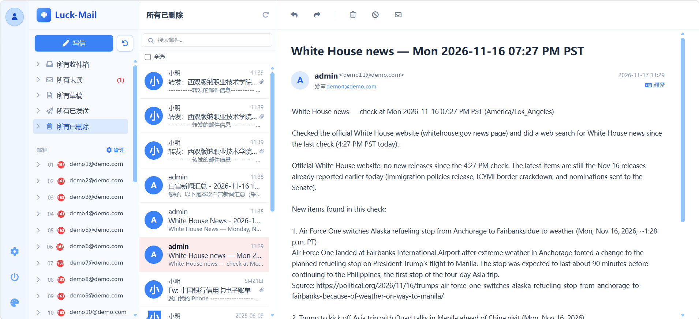

# luck-mail — 轻量开源网页邮箱

[](CHANGELOG.zh-CN.md)

[English version](README.md)



轻量、快速、自托管的网页邮箱，一个地方管多个邮箱。一个登录、一个统一收件箱，不臃肿。**Node.js + Vue 3 + SQLite**。

- **单用户** — 一个登录账号，没有多用户的复杂性。
- **统一收件箱（必须功能）** — 所有邮箱的收件箱按时间汇总；一个账号出问题不影响其他账号。
- **文件夹只同步服务器真实的** — 文件夹列表走 IMAP `LIST` 从服务器同步。有几个列几个，绝不写死、绝不自己编造。
- **知名邮箱自动填服务器** — 163、Gmail、Outlook、QQ、iCloud 等填地址后自动填好服务器。
- **实时推送** — 新邮件经 WebSocket 推送，未读角标即时亮起，不用刷新页面。
- **快** — 单 Node 进程 + SQLite（WAL + FTS5），虚拟滚动、流式解析；附件默认不下载，只记元信息，点下载时再从邮箱服务器实时取。

迁移到新服务器见 [MIGRATION.zh-CN.md](MIGRATION.zh-CN.md)。

## 功能

1. **登录** — 5 次失败锁定 15 分钟。用户名不区分大小写。
2. **添加邮箱** — Foxmail 式表单：邮箱、密码、IMAP 服务器 + SSL + 端口、SMTP 服务器 + SSL + 端口、STARTTLS 勾选。知名邮箱自动填服务器，不常见的默认填 `imap.<域名>` / `smtp.<域名>`。保存前先实测 IMAP + SMTP 连通。**只支持 IMAP**，POP3 已彻底去掉。
3. **邮箱管理** — 弹出框表格：序号、邮箱、备注名（框里直接改，就是别名）、排序（拖拽）、操作（**测试**、邮箱设置、临时停用、删除邮箱）。**测试**按钮不用进设置就能测 IMAP + SMTP 通不通。底部：**+ 添加邮箱**和**导出全部邮箱**（下载真 `.xlsx`，含序号、邮箱名、授权码、IMAP/SMTP 服务器 + 端口、备注）、数量显示、**确定 / 取消**。
4. **统一收件箱** — 聚合视图：所有收件箱、所有未读、所有草稿、所有已发送、所有已删除。点邮箱展开文件夹并切到该邮箱收件箱。未读数实时更新。
5. **邮件列表** — 发件人头像、发件人 + 时间、加粗主题、灰色单行摘要、发件人名前红点未读、选中行浅粉底。复选框悬停出现（手机端常显）。**批量勾选 + 批量删除**（一次最多 200 封；已删除里是彻底删除，其他地方是移入已删除）。删除时按钮倒数剩余数（“删除中（15）…”），提示只属于发起删除的那个视图，列表可滚动（查看/勾选锁定到删完）。**分页** — 每页 50 条，上一页 / 下一页。刷新后回到删除前所在的视图。
6. **阅读窗** — 消毒后的 HTML 在沙盒 iframe 里渲染。发件人悬停出现复制按钮，点一下复制发件人邮箱。发件人日期下面有个**翻译**按钮，点一下英文翻中文，再点回原文（DeepL，密钥放服务器环境变量 `DEEPL_API_KEY`，免费 Key 以 `:fx` 结尾、走 `api-free.deepl.com`）。没有回复全部 / 打印 / 三个点的杂项。
7. **写信** — 主题必填，支持附件；主题为空时自动用第一个附件的文件名填充。发件人下拉列表带序号（【01】、【02】…）。发信附件只记元信息，本体只存邮箱服务器的已发送文件夹，下载已发附件时从 IMAP 实时取。
8. **配色** — 6 种配色（蓝默认、绿、黑白、紫、橙、青），点调色板切换，localStorage 记住选择，滚动条跟着变色。
9. **搜索** — 全文搜索主题、发件人、正文（SQLite FTS5 trigram）。
10. **设置** — 改用户名、改密码（输两次）、默认账号（带序号）、签名、退出。**备份到本地**按钮下载一个 `.tar.gz`，里面是加密密钥 + 一致的数据库快照、正文和附件，解压即可恢复整个安装（见 [MIGRATION.zh-CN.md](MIGRATION.zh-CN.md)）。

## 架构

单 Node 进程 + SQLite。不用 PostgreSQL、Redis、S3、Elasticsearch。

| 层 | 技术 |
|---|---|
| 后端 | Node 22 + Express + TypeScript（strict）+ Socket.io + better-sqlite3 |
| 邮件 | imapflow（IDLE + 增量同步）+ Nodemailer（发信）+ mailparser（流式解析） |
| 前端 | Vue 3 + Vite + TypeScript（strict）+ Pinia + Tailwind + socket.io-client |
| 存储 | SQLite（WAL + FTS5 trigram）；消毒后的 HTML 正文存文件；附件只记元信息，下载时从 IMAP 实时取，不落盘 |
| 安全 | AES-256-GCM 邮箱密码加密；DOMPurify + JSDOM 消毒；沙盒 iframe（srcdoc）渲染正文 |

**邮件怎么走：** 前端只跟 Node 后端建一个 WebSocket（Socket.io），不直连 IMAP。imapflow 给每个邮箱保持一条 IDLE 长连接；收到新邮件时后端经 WebSocket 推 JSON 给 Vue，更新未读数和列表。删信时先在服务器上做 IMAP 操作（移入已删除，或彻底删除时清掉），再改本地数据库——客户端和服务器始终一致。

## 知名邮箱自动填服务器

加邮箱时，填邮箱地址后服务器自动填好。举几个例子：

| 服务商 | 域名 | IMAP | SMTP | 密码提示 |
|---|---|---|---|---|
| 网易 | 163.com / 126.com / yeah.net / 188.com | imap.163.com:993 SSL | smtp.163.com:465 SSL | 客户端授权码 |
| Gmail | gmail.com / googlemail.com | imap.gmail.com:993 SSL | smtp.gmail.com:587 STARTTLS | 应用专用密码 |
| Outlook/Hotmail | outlook.com / hotmail.com / live.com / msn.com | outlook.office365.com:993 SSL | smtp.office365.com:587 STARTTLS | — |
| QQ 邮箱 | qq.com / foxmail.com | imap.qq.com:993 SSL | smtp.qq.com:465 SSL | 授权码 |
| 腾讯企业邮箱 | （按名选择） | imap.exmail.qq.com:993 SSL | smtp.exmail.qq.com:465 SSL | — |
| Yahoo | yahoo.com / ymail.com / rocketmail.com | imap.mail.yahoo.com:993 SSL | smtp.mail.yahoo.com:465 SSL | 应用专用密码，先开 IMAP |
| iCloud | icloud.com / me.com / mac.com | imap.mail.me.com:993 SSL | smtp.mail.me.com:587 STARTTLS | 应用专用密码 |
| AOL | aol.com / aim.com | imap.aol.com:993 SSL | smtp.aol.com:465 SSL | 应用专用密码 |
| Yandex | yandex.com / yandex.ru / ya.ru | imap.yandex.com:993 SSL | smtp.yandex.com:465 SSL | 应用专用密码，先开 IMAP |
| Zoho | zoho.com / zohomail.com | imap.zoho.com:993 SSL | smtp.zoho.com:465 SSL | — |

注意：ProtonMail 没有直接 IMAP（须用本地 Proton Bridge），故意不做预设。

## 快速开始

### 手动跑（Node）

```bash
cd backend && npm install && npm run build
cd ../frontend && npm install && npm run build
```

启动后端：

```bash
PORT=8080 DATA_DIR=/path/to/data PUBLIC_DIR=backend/public KEY_FILE=/path/to/.key node backend/dist/server.js
```

环境变量：

| 变量 | 默认 | 说明 |
|---|---|---|
| `PORT` | 8080 | HTTP 端口 |
| `DATA_DIR` | `./data` | SQLite 数据库、正文、附件 |
| `PUBLIC_DIR` | `backend/public` | 构建好的前端文件 |
| `KEY_FILE` | `./data/.key` | AES-256-GCM 密钥（邮箱密码加密用，0600）。**丢了则已存邮箱密码无法解密，须重新添加邮箱。** |
| `COOKIE_SECURE` | 0 | HTTPS 后面设为 `1` |
| `MAIL_PARSE_WORKER_THRESHOLD_BYTES` | `5242880`（5MB） | 正文超过这个大小时扔到 worker 线程里解析，不占主线程 |
| `DEEPL_API_KEY` | — | DeepL 翻译密钥（正文翻译用；免费 Key 以 `:fx` 结尾、走 `api-free.deepl.com`）。不配则翻译按钮报错 |

数据在 `DATA_DIR` 里（`luck-mail.db` + `bodies/` + `attachments/`）。**升级前先备份这个目录。**

## 目录结构

```
backend/                 # Node + Express + TypeScript
  src/
    server.ts            # 入口：HTTP + Socket.io
    engine.ts            # IMAP 引擎（同步、文件夹、读/删/移动）
    db.ts                # SQLite 结构、FTS5、墓碑表
    cryptoUtil.ts        # AES-256-GCM 加密/解密
    imapUtil.ts          # IMAP 客户端工厂（含 ID 命令）
    smtpUtil.ts          # SMTP 发信
    presets.ts           # 知名邮箱服务器预设
    routes/              # auth / account / message / misc 路由
  scripts/verify-all.mjs # 端到端验证脚本
frontend/                # Vue 3 + Vite + TypeScript + Pinia
  src/
    views/               # LoginView、MailView
    components/          # 侧栏、邮件列表、阅读窗、写信弹窗、各弹窗
    stores/              # mail（全局）、auth、theme
    api.ts               # REST 客户端
    realtime.ts          # Socket.io 客户端
API_CONTRACT.md          # 前后端 API 合同
LICENSE                  # AGPL-3.0
```

## 安全

- 邮箱密码（授权码、应用专用密码）用 AES-256-GCM 加密，密钥文件放在数据库外面。密钥文件丢了，已存密码无法恢复，只能重新添加邮箱。
- 登录：5 次失败锁定 15 分钟。“30 天内免登录”用轮换 token，只存 token 的哈希。
- 邮件正文经 DOMPurify 消毒，在沙盒 iframe（`srcdoc`）里渲染。
- 删信先在服务器上做 IMAP 操作、再改本地数据库，服务器删失败时本地不动，两边不会不一致。彻底删除的信记入墓碑表，同步抖动也不会把它复活回来。
- 加邮箱时，解析到内网 / 保留地址的主机名会被拒绝。

## 开发

```bash
# 后端（监听模式）
cd backend && npm run dev
# 前端（监听模式）
cd frontend && npm run dev
```

前后端 API 见 `API_CONTRACT.md`。前端不直连 IMAP，所有操作都走后端 REST API 和一个 Socket.io 连接。

## 许可证

AGPL-3.0。见 `LICENSE`。
